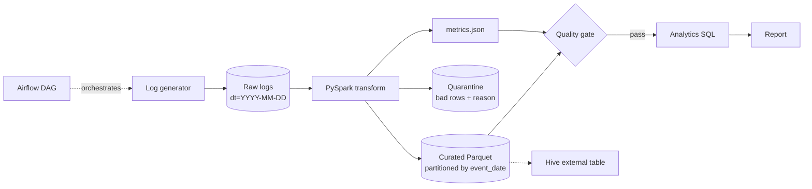

# Clickstream Pipeline

[](https://github.com/RyukR1/Clickstream_analysis/actions/workflows/ci.yml)

A batch data pipeline that turns raw web-server logs into validated, date-partitioned Parquet and answers product questions with SQL. Bad records are quarantined with a reason instead of dropped, every run reconciles its row counts, and a quality gate decides whether the data is published.

The logs are synthetic (generated by `src/clickstream/generate.py`), so the project runs anywhere without credentials. The generator injects malformed lines, errors, static assets and a few bot IPs so the cleaning and checks have real work to do.

## Architecture



## Quick start

Requires Python 3.10+ and Java 17 or 21 (for Spark).

```bash
make setup
make demo ROWS=200000 DAYS=7
```

`make demo` generates logs, runs the transform, runs the quality gate, and writes `results/analysis_results.txt`. A sample is in [docs/sample_analysis_results.txt](docs/sample_analysis_results.txt).

| Command | What it does |
| --- | --- |
| `make generate` | Write synthetic access logs to `data/raw/` |
| `make etl` | Parse, clean and write partitioned Parquet, quarantine and `metrics.json` |
| `make quality` | Run the quality gate; exits non-zero on failure |
| `make report` | Run `sql/analytics.sql` over the curated data |
| `make test` / `make lint` | Run pytest / ruff and shellcheck |
| `make benchmark` | Re-measure Parquet and partitioning on your machine |

## What the transform does

1. Parses each line with one regex into ip, timestamp, method, URL, protocol, status and bytes.
2. Classifies every line exactly once: kept, rejected (`unparseable`, `bad_timestamp`) or filtered (`non_success_status`, `static_asset`).
3. Writes kept rows to Parquet partitioned by `event_date`, using dynamic partition overwrite so a rerun replaces only the days it touches.
4. Writes rejected rows, with the original line and the reason, to a quarantine path.
5. Writes `metrics.json` with a count for every outcome.

A 200,000-line demo run reports: 134,570 kept, 2,002 rejected (1,205 unparseable, 797 bad timestamp), 63,428 filtered (17,206 non-success status, 46,222 static assets).

## Data quality gate

`clickstream.quality` fails the run if any check fails:

- **Reconciliation:** kept + rejected + filtered equals total input lines.
- **Reject rate:** rejected lines stay under a threshold (default 5%).
- **Output count:** Parquet row count equals the kept count in the metrics.
- **No null keys:** ip, event_ts, url, status and event_date are never null.
- **Invariants:** no non-200 rows and no static assets in the curated data.
- **Partition dates:** every partition is a valid date, optionally inside an expected window.

## Results

Measured on a 2-CPU Linux machine, Spark 4.3.0 in local mode. Full table and caveats in [docs/benchmark.md](docs/benchmark.md); rerun with `make benchmark`.

| Metric | Value |
| --- | --- |
| Input | 2,000,000 log lines over 30 days |
| ETL wall time | 32.6 s |
| Curated size, CSV text vs partitioned Parquet | 107.2 MB vs 19.0 MB (82% smaller) |
| One-day query, CSV text | 1.49 s |
| One-day query, partitioned Parquet | 0.18 s (8.3x faster) |
| Partition pruning in the query plan | confirmed |

Partitioned and unpartitioned Parquet performed about the same at this size (0.18 s vs 0.15 s). The unpartitioned copy is already in time order, so Parquet statistics skip most data anyway. The gain here comes from the columnar format; partitioning is a design choice for larger or less ordered data.

## Analytics

[sql/analytics.sql](sql/analytics.sql) holds seven queries written to run on both Spark SQL and Hive: top pages, daily traffic with unique visitors, top three pages per day (window function), hourly pattern, traffic by site section, bot candidates, and a purchase funnel. The five injected bot IPs rank first in `bot_candidates`.

To query the curated data from Hive, point the external table at it:

```bash
hive --hivevar curated_location=/path/to/curated -f hive/create_tables.hql
```

## Orchestration

[dags/clickstream_daily.py](dags/clickstream_daily.py) defines a daily Airflow DAG: `ingest_raw_logs`, `transform_to_parquet`, `quality_gate`, `publish_report`. Each run works on its own `dt={{ ds }}` input and writes only its own partition, so retries and backfills are safe. Set `CLICKSTREAM_HOME` to the project path on the Airflow worker.

## Design decisions

- **Quarantine instead of drop.** Bad lines are kept with a reason, so data loss is visible and fixable.
- **Reconciliation on every run.** Silent loss is the most common pipeline failure; the gate makes it loud.
- **Idempotent writes.** Dynamic partition overwrite plus per-day inputs mean a rerun gives the same result.
- **Parquet over CSV.** Typed columns, compression and column pruning; 82% smaller in the benchmark.
- **One SQL file for Spark and Hive.** The same queries are tested in CI on Spark and usable on a Hive table.

## Testing

`make test` runs 16 tests: generator determinism and format, every transform outcome (kept, rejected, filtered), idempotent reruns, each quality check failing when it should, and every analytics query executing. GitHub Actions runs lint, shellcheck, the tests and an end-to-end demo on each push.

## Legacy Hadoop stack

The first version used Pig and Hive on a Hadoop container and is kept for comparison. See [docs/hadoop-stack.md](docs/hadoop-stack.md).

## Limitations

- Data is synthetic and the benchmark is a small local run, not a cluster.
- The Airflow DAG compiles but has not been run against a live Airflow instance in this repository.
- The Hive DDL and the legacy Pig fixes were not run against a live Hadoop container here.
- Flume config in `phase1_ingestion/` is documentation only; nothing runs it.

## Project layout

```text
src/clickstream/   generate, transform, quality, report, benchmark
sql/               analytics queries (Spark SQL and Hive compatible)
hive/              external table DDL for the curated Parquet
dags/              Airflow DAG
tests/             pytest suite
docs/              benchmark, sample output, Hadoop stack notes
phase1_ingestion/  Flume config (legacy, unused)
phase2_cleaning/   Pig script (legacy)
phase3_analysis/   Hive queries (legacy)
hadoop_config/     Hadoop XML configs for the legacy container
*.sh, Dockerfile   legacy Hadoop container scripts
```
