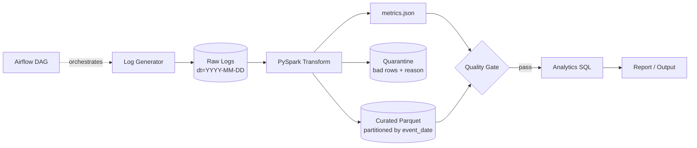

# Clickstream Pipeline

[](https://github.com/RyukR1/Clickstream_analysis/actions/workflows/ci.yml)

A batch data engineering pipeline that turns raw web-server logs into validated, date-partitioned Parquet, enforces data quality gates, and answers product questions with SQL. Malformed records are quarantined with an explicit reason rather than dropped, runs reconcile row counts end-to-end, and daily jobs are orchestrated via Apache Airflow.

Logs are synthetic (generated by `src/clickstream/generate.py`) to run anywhere without credentials. The generator injects malformed lines, HTTP errors, static assets, and bot traffic to test cleaning and quality checks under realistic conditions.

---

## Architecture



---

## Quick Start

### Prerequisites
* **Python 3.10+** (Python 3.11 recommended)
* **Java 17 or 21** (e.g. Eclipse Temurin OpenJDK)
* [`uv`](https://github.com/astral-sh/uv) or standard `pip`

```bash
# 1. Create virtual environment and install dependencies
uv venv --python 3.11 .venv
source .venv/bin/activate
uv pip install -e ".[dev,airflow]"

# 2. Run the test suite (16 unit and integration tests)
make test

# 3. Run the end-to-end demo pipeline
make demo ROWS=50000 DAYS=7
```

`make demo` generates raw access logs, runs the PySpark ETL transform, validates outputs with the data quality gate, and generates `results/analysis_results.txt`.

---

## Commands Reference

| Command | Description |
| --- | --- |
| `make test` | Run pytest suite (16 tests covering ETL, quality checks, queries, generator) |
| `make lint` | Run ruff code quality checks |
| `make demo` | Generate logs, run PySpark ETL, execute quality gate, and print report |
| `make generate` | Write synthetic access logs to `data/raw/` (`ROWS=... DAYS=...`) |
| `make etl` | Parse logs, write date-partitioned Parquet, quarantine, and `metrics.json` |
| `make quality` | Run data quality gate (reconciliation, reject rate, null & invariant checks) |
| `make report` | Execute `sql/analytics.sql` over curated Parquet to `results/analysis_results.txt` |
| `make benchmark` | Benchmark Parquet vs CSV storage size, query execution, and partition pruning |
| `make airflow-test` | Execute a single daily Airflow DAG run (`DATE=YYYY-MM-DD`) |
| `make airflow-standalone` | Launch Airflow Standalone (Webserver + Scheduler) at `http://localhost:8080` |
| `make clean` | Remove temporary build files, test caches, and generated data |

---

## What the Transform Does

1. **Regex Extraction**: Parses each log line into `ip`, `timestamp`, `method`, `url`, `protocol`, `status`, and `bytes`.
2. **Explicit Classification**: Every line is classified once into:
   * **Kept**: Valid 200 OK page views.
   * **Rejected** (Quarantined): `unparseable` syntax or `bad_timestamp`. Preserved with original line and reason.
   * **Filtered**: `non_success_status` (404, 500, etc.) and `static_asset` (.css, .js, images).
3. **Partitioned Storage**: Writes kept rows to Parquet partitioned by `event_date` (`YYYY-MM-DD`) with dynamic partition overwrite for idempotent reruns.
4. **Audit Metrics**: Emits execution statistics into `metrics.json` tracking totals for every category.

---

## Data Quality Gate

`clickstream.quality` halts the pipeline if any check fails:

* **Reconciliation**: Asserts $\text{Total Input} = \text{Kept} + \text{Rejected} + \text{Filtered}$.
* **Reject Rate**: Asserts rejected lines remain under threshold (default 5%).
* **Output Row Count**: Verifies written Parquet records equal the kept count in `metrics.json`.
* **No Null Keys**: Primary dimensions (`ip`, `event_ts`, `url`, `status`, `event_date`) must be non-null.
* **Invariants**: Verifies zero non-200 HTTP statuses and zero static assets leaked into curated storage.
* **Partition Dates**: Asserts partition directories match valid calendar dates within the expected window.

---

## Analytics

[`sql/analytics.sql`](sql/analytics.sql) contains 7 analytical queries executed across curated Parquet:

1. **Top Pages**: Most requested URLs and unique visitor counts.
2. **Daily Traffic**: Daily clicks and unique visitors (DAU).
3. **Top 3 Pages per Day**: Windowed daily page rankings using `DENSE_RANK()`.
4. **Hourly Traffic**: Diurnal hourly activity patterns.
5. **Traffic by Section**: Traffic aggregated across website sections (`/products`, `/cart`, etc.).
6. **Bot Candidates**: High-volume IPs making requests across all distinct pages.
7. **Purchase Funnel**: Conversion progression:
   $$\text{products } (100\%) \longrightarrow \text{cart } (25.3\%) \longrightarrow \text{checkout } (14.6\%) \longrightarrow \text{payment } (9.1\%) \longrightarrow \text{order-confirmation } (6.8\%)$$

---

## Orchestration with Airflow

[`dags/clickstream_daily.py`](dags/clickstream_daily.py) defines a production-ready daily DAG:

$$\text{ingest\_raw\_logs} \longrightarrow \text{transform\_to\_parquet} \longrightarrow \text{quality\_gate} \longrightarrow \text{publish\_report}$$

* **Daily Partition Isolation**: Ingests `data/raw/dt={{ ds }}` and writes only to `data/curated/event_date={{ ds }}`.
* **Deterministic Backfills**: Uses `{{ ds_nodash }}` as random seed so re-runs of historical days produce identical data.
* **Independent Run Artifacts**: Writes quarantine, quality metrics, and reports per execution date into `data/runs/{{ ds }}/`.

Test a single execution date:
```bash
make airflow-test DATE=2026-04-06
```

Launch the local Airflow UI:
```bash
make airflow-standalone
```
* Access UI at `http://localhost:8080` (login credentials printed in terminal).

---

## Project Layout

```text
Clickstream_analysis/
├── src/clickstream/          # Core PySpark package
│   ├── __init__.py           # Package init & automatic JVM discovery
│   ├── transform.py          # PySpark ETL, regex parsing & quarantine
│   ├── quality.py            # Data quality gate & reconciliation
│   ├── report.py             # SQL analytics execution engine
│   ├── generate.py           # Synthetic access log generator
│   └── benchmark.py          # Performance & storage benchmarking
├── sql/
│   └── analytics.sql         # 7 analytical queries
├── dags/
│   └── clickstream_daily.py  # Apache Airflow daily batch DAG
├── tests/                    # 16 pytest unit and integration tests
├── docs/                     # Benchmark results & sample reports
├── .github/workflows/ci.yml  # GitHub Actions CI workflow
├── pyproject.toml            # Python packaging & dependencies
└── Makefile                  # Command runner
```
